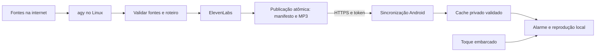

# Arquitetura e contratos propostos

## Fluxo

## Pipeline no servidor

1. Adquirir lock para não gerar a mesma edição simultaneamente. Identificar edição por data editorial, perfil e revisão.
2. Pesquisar via `agy`, com prazo máximo, limites de saída e número limitado de tentativas. Executar por argumentos, nunca construir comandos de shell com texto de notícias.
3. Exigir saída estruturada: título, fonte, URL, data de publicação quando disponível, horário de consulta, resumo e referências utilizadas. Inspecionar como o `agy` instalado faz buscas; não presumir flags, API, agendamento permitido ou acesso ilimitado.
4. Verificar URLs, atualidade e duplicatas; cruzar fontes para afirmações relevantes. Não aceitar como evidência apenas um resumo do agente. Conteúdo externo é dado não confiável, sem autoridade para executar comandos ou ler segredos.
5. Produzir roteiro curto, com data e distinção entre fatos e incertezas. Preferir omitir uma matéria sem suporte a preencher duração inventando conteúdo. No MVP, temas configurados e fontes permitidas; sem recomendações médicas ou financeiras personalizadas.
6. Validar tamanho, duração estimada e orçamento antes de chamar ElevenLabs. Registrar modelo/voz, caracteres e consumo quando informado pelo provedor, sem registrar a chave.
7. Reutilizar áudio por hash do texto normalizado, voz, modelo e configurações. Persistir cada etapa para retomar após falha. Em timeout ambíguo, verificar o estado antes de repetir para reduzir cobranças duplicadas.
8. Gerar em diretório temporário; validar que o áudio decodifica, tem duração e tamanho plausíveis. Publicar arquivos imutáveis e trocar o ponteiro da edição atual atomicamente somente após tudo estar pronto.

Se `agy` falhar: tentar novamente dentro do prazo; opcionalmente consultar feeds RSS previamente aprovados. RSS sem sumarizador disponível permite um boletim determinístico de manchetes com atribuição, se essa política estiver habilitada. Se não houver fontes válidas, preservar edição anterior e registrar falha. Nenhum fallback exige contratar outro provedor automaticamente.

## Contrato HTTP v1 (a implementar)

- `GET /healthz`: saúde mínima, sem segredos; não confundir processo vivo com edição pronta.
- `GET /v1/editions/latest`: manifesto completo mais recente; 404 quando não houver edição. Suportar ETag/304 e autenticação.
- `GET /v1/editions/{edition_id}`: manifesto imutável de uma edição.
- `GET /v1/assets/{asset_id}`: arquivo autorizado, com tamanho e tipo conhecidos; não aceitar caminhos arbitrários.

Manifesto terá `schema_version`, `edition_id`, `editorial_date`, `timezone`, `generated_at`, `expires_at`, `script`, `sources` e `assets`. Cada asset contém `id`, `role` (`narration` ou `music`), caminho relativo na API, `mime_type`, `bytes`, `sha256` e `duration_seconds`. Datas de instantes usam ISO 8601 com offset. A data editorial é YYYY-MM-DD. Validar versão suportada e rejeitar campos obrigatórios ausentes.

Não colocar tokens nos URLs. Download só do mesmo servidor configurado; redirects e URLs externos não devem receber o token do dispositivo. Limitar tamanho de manifesto, número e tamanho de arquivos, tempo de download e espaço de cache.

O app baixa para temporário, verifica tamanho/hash e capacidade de reprodução, e só então promove a edição em transação local. Uma falha não troca a edição ativa. Guardar edição atual e anterior, respeitando limite de disco; nunca remover a última válida antes da promoção.

## Android: alarme e permissões

Usar `setAlarmClock()` para o próximo disparo e reagendar recorrências individualmente. Verificar capacidade de agendar alarmes exatos, mudança de horário/fuso, atualização do app e reinício. WorkManager cuida do download antecipado e tentativas com backoff, sem compromisso de minuto exato. Alterar o horário no celular não depende do servidor; até haver sincronização de preferências, o servidor gera em janela configurada independentemente do alarme.

Reprodução local em serviço de primeiro plano, com sessão de mídia e controles. Validar audio focus, uso de áudio de alarme, início de serviço a partir do disparo, notificações e comportamento da tela bloqueada na versão instalada. Parar e soneca devem funcionar offline, cancelar a sessão anterior e não duplicar disparos.

| Capacidade | Política |
| --- | --- |
| Internet | Sincronização apenas; sem dependência no disparo |
| Alarmes exatos | Escolher SCHEDULE_EXACT_ALARM ou USE_EXACT_ALARM conforme Android, finalidade e distribuição; não pedir ambas sem necessidade |
| Serviço em primeiro plano e reprodução | Declarar permissões/tipo exigidos pela versão alvo |
| Notificações | Solicitar quando necessário para experiência de controles/alertas na versão instalada |
| Reinício | RECEIVE_BOOT_COMPLETED para restaurar agendamento; definir comportamento antes do primeiro desbloqueio |
| Arquivos de música | Se habilitado, seletor de arquivo do sistema; copiar para cache privado, sem acesso geral ao armazenamento |
| Tela cheia | Fora do MVP até demonstrar necessidade e conferir regras aplicáveis |

Não solicitar exclusão das otimizações de bateria por padrão. Primeiro medir no S24 FE; se houver falha reproduzível, documentar o ajuste mínimo e sua justificativa. Não alterar NFC, serviços do Google ou políticas de segurança. Não Perturbe é configuração do usuário, sem pedir acesso amplo para modificá-lo automaticamente.

Para reinício antes do desbloqueio, decidir e testar Direct Boot: se adotado, manter somente configuração mínima e toque de reserva em armazenamento protegido por dispositivo, sem tokens nem dados editoriais privados. Não declarar suporte antes desse teste.

## Fallbacks

| Falha | Comportamento |
| --- | --- |
| Servidor, rede ou sincronização indisponível | Edição local válida; nenhuma chamada de rede no disparo |
| Download parcial, hash errado ou disco cheio | Preservar edição anterior; descartar temporário |
| Jornal vencido | Aviso local pré-gravado e toque/música; opção futura explícita para ouvir edição anterior com data |
| Nenhuma edição baixada | Toque embarcado independente do servidor e do TTS |
| TTS sem crédito ou indisponível | Não republicar como sucesso; manter áudio válido, respeitando validade |
| MP3 falha ao tocar | Mudar imediatamente para toque embarcado, com limite de tentativas |
| Música ausente | Jornal e toque continuam funcionando |
| Permissão de alarme revogada | Exibir indisponibilidade e orientar correção; nunca mostrar “pronto” |

O sinal local inicial confirma o disparo mesmo quando o jornal falha. Separar “alarme pronto” de “jornal atualizado”. Aplicar expiração também no instante de reprodução, não só no download.

## Custos e operação

Começar com uma edição diária de 3–5 minutos como hipótese ajustável. Medir caracteres e créditos de uma amostra real antes de projetar o mês. Definir teto por edição, teto mensal, limite de retries e bloqueio quando o orçamento acabar. Plano pago não significa uso ilimitado.

Logs devem informar etapa, edição, duração, falha e consumo, sem credenciais. Indicadores mínimos: última geração bem-sucedida, idade da edição, última sincronização no app e motivo do fallback. Retenção sugerida: sete edições no servidor e duas no celular, sujeita a limite de disco e validade editorial.

## Referências oficiais consultadas

- [Alarmes Android](https://developer.android.com/develop/background-work/services/alarms)
- [Reprodução em segundo plano com Media3](https://developer.android.com/media/media3/session/background-playback)

Revalidar regras e versões durante a implementação; estes documentos não substituem testes no aparelho.
