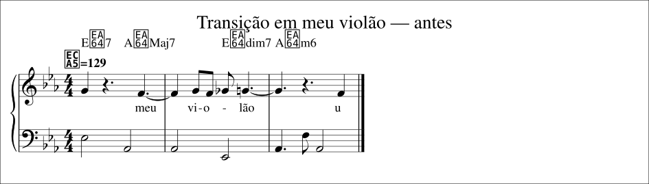
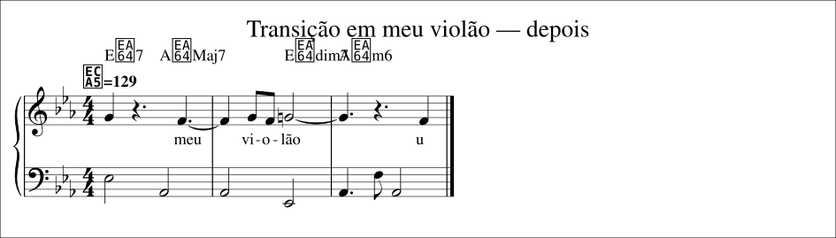
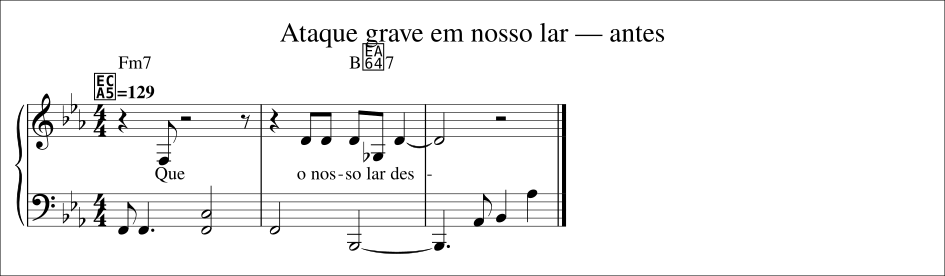
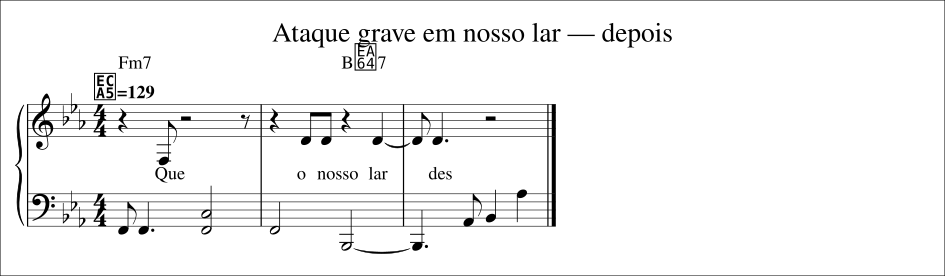
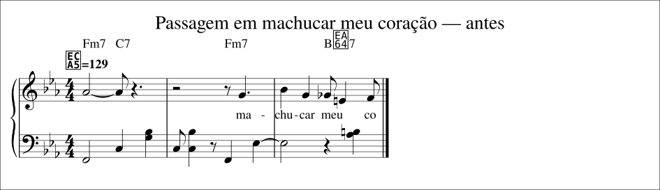
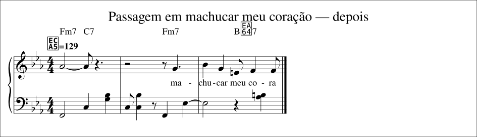
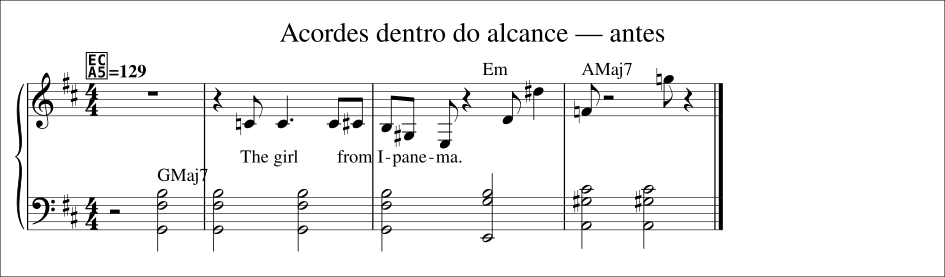
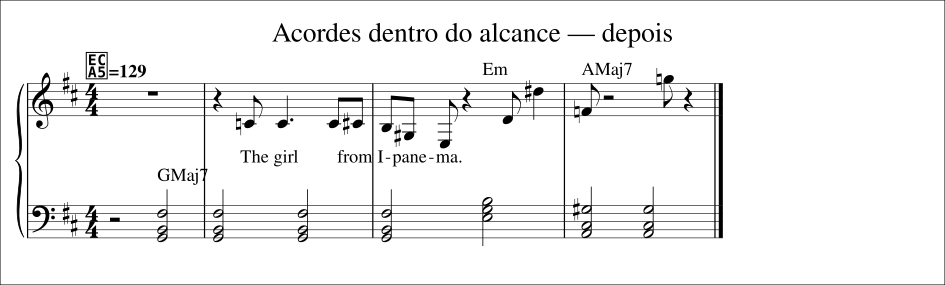
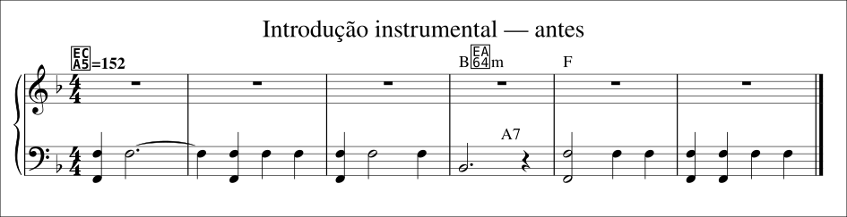
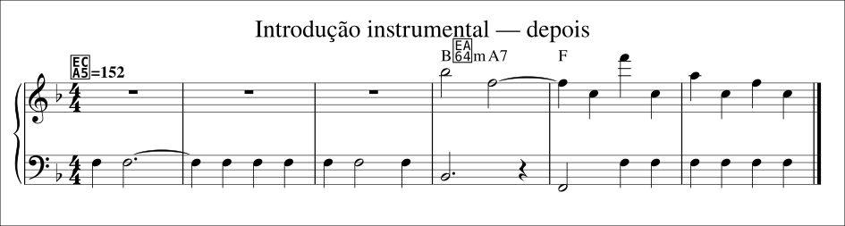

# Exemplos para comparar antes e depois

Cinco recortes curtos de arranjos gerados pelo Partitura. Os arquivos estão prontos
para abrir; não é necessário baixar modelos nem executar a geração para compará-los.

Cada exemplo contém partitura em **SVG e PDF**, áudio de **piano MP3**, **MIDI** e
**MusicXML** editável, além de `comparacao.json` com origem, intervalo e medidas.

## Como comparar

Veja as imagens lado a lado e ouça os dois MP3s na ordem que preferir. No GitHub,
use Raw/Download se o navegador não reproduzir o MP3 diretamente; após clonar ou
baixar os arquivos, eles podem ser abertos em qualquer player.

Os dois lados usam o mesmo trecho, andamento, armadura e piano. Os áudios foram
sintetizados novamente a partir das notas dos recortes. São exemplos do resultado
da evolução do pipeline, não gravações originais nem partituras oficiais.

Os snapshots históricos podem diferir também em alinhamento da letra e outras
revisões do arranjo. Não constituem um experimento isolado de uma única regra nem
uma prova de preferência musical. O protocolo para isso está no [plano da próxima etapa](../PROXIMA_ETAPA.md).

| Exemplo | O que observar |
|---|---|
| [1. Violão](#1-transição-em-meu-violão) | O degrau cromático curto que a grade alongava. |
| [2. Nosso lar](#2-ataque-grave-em-nosso-lar) | Uma excursão grave no ataque da melodia. |
| [3. Meu coração](#3-passagem-em-machucar-meu-coração) | O Fá♯ de passagem que virava nota em “meu”. |
| [4. Alcance](#4-acordes-dentro-do-alcance) | Abertura máxima da esquerda reduzida de 19 a 11 semitons. |
| [5. Introdução](#5-introdução-instrumental) | A direita instrumental que o Híbrido descartava. |

## 1. Transição em “meu violão”

**Para Machucar Meu Coração — Híbrido AMT, Médio.** Três compassos, aproximadamente 5,6 s de música.
Na versão anterior, uma altura intermediária da subida Fá–Sol aparece como nota
separada. A proteção evita que essa transição vire uma nota longa no piano.

| Antes | Depois |
|---|---|
|  |  |

**Ouvir:** [antes](01-violao/antes.mp3) · [depois](01-violao/depois.mp3).

**Arquivos:** [PDF antes](01-violao/antes.pdf) · [PDF depois](01-violao/depois.pdf) ·
[MIDI antes](01-violao/antes.mid) · [MIDI depois](01-violao/depois.mid) ·
[MusicXML antes](01-violao/antes.musicxml) · [MusicXML depois](01-violao/depois.musicxml) ·
[medidas e origem](01-violao/comparacao.json).

## 2. Ataque grave em “nosso lar”

**Para Machucar Meu Coração — Híbrido AMT, Médio.** Três compassos, aproximadamente 5,6 s de música.
A versão anterior promove um ataque grave suspeito a nota melódica. No resultado
revisto, a entrada se apoia na altura estável da frase.

| Antes | Depois |
|---|---|
|  |  |

**Ouvir:** [antes](02-nosso-lar/antes.mp3) · [depois](02-nosso-lar/depois.mp3).

**Arquivos:** [PDF antes](02-nosso-lar/antes.pdf) · [PDF depois](02-nosso-lar/depois.pdf) ·
[MIDI antes](02-nosso-lar/antes.mid) · [MIDI depois](02-nosso-lar/depois.mid) ·
[MusicXML antes](02-nosso-lar/antes.musicxml) · [MusicXML depois](02-nosso-lar/depois.musicxml) ·
[medidas e origem](02-nosso-lar/comparacao.json).

## 3. Passagem em “machucar meu coração”

**Para Machucar Meu Coração — Híbrido AMT, Médio.** Três compassos, aproximadamente 5,6 s de música.
Na versão anterior, a passagem da voz entre “meu” e “coração” vira um Sol♭ (o Fá♯
intermediário) em “meu”, seguido de um Mi sem sílaba. No resultado revisto, “meu” fica
no Mi e “co-ra” no Fá, sem o degrau de passagem. O recorte antigo (“desmoronou”) saiu
com as mesmas notas nos dois lados e foi trocado em 2026-11-10.

| Antes | Depois |
|---|---|
|  |  |

**Ouvir:** [antes](03-meu-coracao/antes.mp3) · [depois](03-meu-coracao/depois.mp3).

**Arquivos:** [PDF antes](03-meu-coracao/antes.pdf) · [PDF depois](03-meu-coracao/depois.pdf) ·
[MIDI antes](03-meu-coracao/antes.mid) · [MIDI depois](03-meu-coracao/depois.mid) ·
[MusicXML antes](03-meu-coracao/antes.musicxml) · [MusicXML depois](03-meu-coracao/depois.musicxml) ·
[medidas e origem](03-meu-coracao/comparacao.json).

## 4. Acordes dentro do alcance

**Garota de Ipanema — Acordes, Médio.** Quatro compassos.
As notas do acompanhamento são reposicionadas por oitavas. Neste recorte, a maior
abertura da esquerda cai de **19 para 11 semitons**, e os sete ataques polifônicos
que ultrapassavam uma oitava deixam de ultrapassá-la. Isso mede alcance; não prova
que toda escolha harmônica seja correta.

O texto em inglês no início é uma falha conhecida da transcrição da letra nessa
gravação. Este exemplo compara o alcance das mãos; não valida essa letra.

| Antes | Depois |
|---|---|
|  |  |

**Ouvir:** [antes](04-alcance/antes.mp3) · [depois](04-alcance/depois.mp3).

**Arquivos:** [PDF antes](04-alcance/antes.pdf) · [PDF depois](04-alcance/depois.pdf) ·
[MIDI antes](04-alcance/antes.mid) · [MIDI depois](04-alcance/depois.mid) ·
[MusicXML antes](04-alcance/antes.musicxml) · [MusicXML depois](04-alcance/depois.musicxml) ·
[medidas e origem](04-alcance/comparacao.json).

## 5. Introdução instrumental

**No Surprises — Híbrido AMT, Médio.** Seis compassos, aproximadamente 9,5 s de música.
A direita passa de **zero para nove notas** neste recorte. Elas vêm do arranjo
instrumental da IA; não se trata de uma introdução composta do zero. Avalie se o
motivo ficou mais reconhecível, sem presumir transcrição perfeita da gravação.

| Antes | Depois |
|---|---|
|  |  |

**Ouvir:** [antes](05-introducao/antes.mp3) · [depois](05-introducao/depois.mp3).

**Arquivos:** [PDF antes](05-introducao/antes.pdf) · [PDF depois](05-introducao/depois.pdf) ·
[MIDI antes](05-introducao/antes.mid) · [MIDI depois](05-introducao/depois.mid) ·
[MusicXML antes](05-introducao/antes.musicxml) · [MusicXML depois](05-introducao/depois.musicxml) ·
[medidas e origem](05-introducao/comparacao.json).

## Origem e reprodução

Intérpretes das gravações usadas na biblioteca: Stan Getz & João Gilberto em
Para Machucar Meu Coração, João Gilberto em Garota de Ipanema e Radiohead em No Surprises.
Os recortes foram extraídos das partituras automáticas e dos backups locais do projeto.

O [manifesto](manifesto.json) registra intervalos, andamento, origem relativa,
medidas, tamanho e SHA-256 dos arquivos. PDFs/SVGs usam a mesma armadura nos dois
lados de cada comparação. Cada MP3 tem um segundo final reservado à cauda do piano.

Para reconstruir a seleção a partir da biblioteca e dos backups locais:

```powershell
cd partitura
.\venv\Scripts\python.exe gerar_exemplos.py
```

Essa reconstrução usa os arquivos locais ignorados pelo Git, as dependências de
notação e o sintetizador do projeto. Os exemplos prontos desta pasta dispensam
esses arquivos de origem e continuam disponíveis em um clone novo do repositório.

Para uma comparação musical mais completa, consulte a [análise da biblioteca](../ANALISE_PARTITURAS.md).
